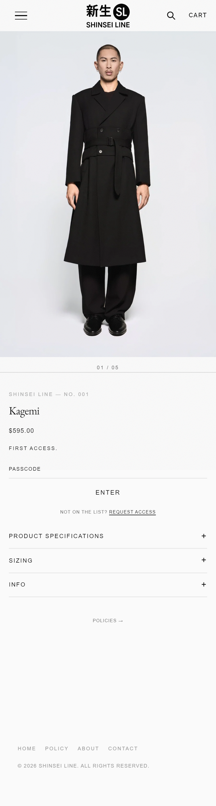
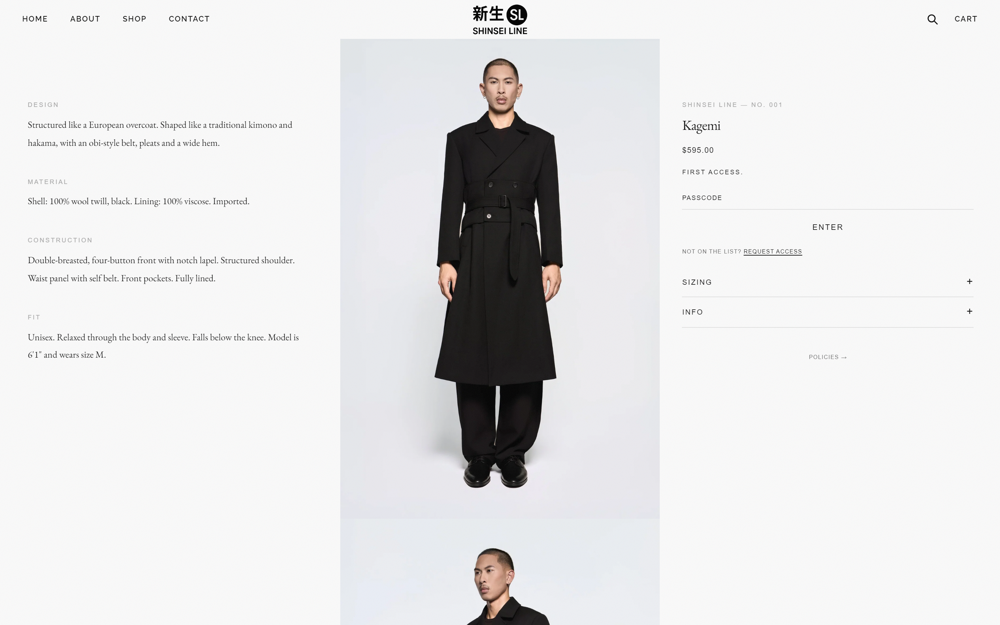
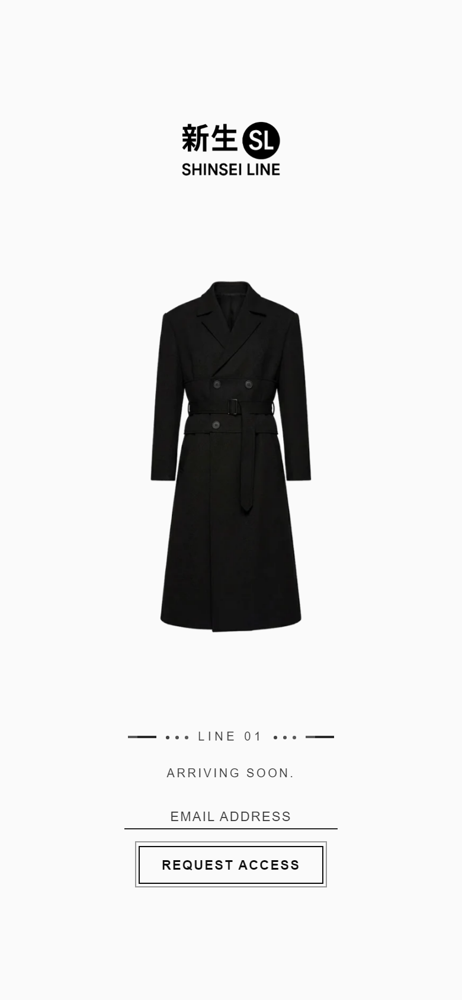
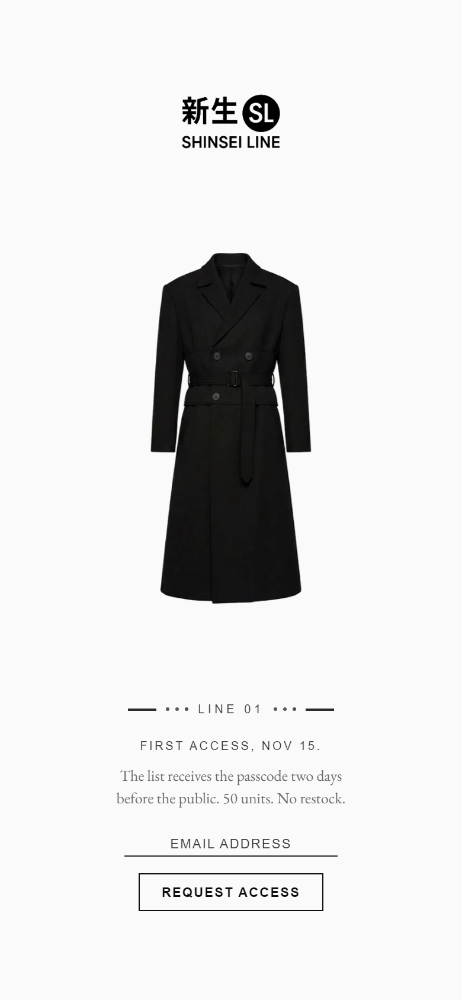

# nl-modules

**Portable, editor-friendly Shopify theme modules, extracted from a real luxury storefront.**

I built the [Shinsei Line](https://theshinseiline.com) storefront: a limited-run outerwear label with a quiet, monochrome, transit-inspired look. The first version looked right but was hard to run. Every word on the product page lived in Liquid code, and changing a measurement meant a code deploy. This repo is the result of refactoring it into modules that a merchant edits in the theme editor and a developer can drop into any Online Store 2.0 theme.

| Module | What it does |
|---|---|
| [nl-spec-list](nl-spec-list) | Product specifications (Design, Material, Construction, Fit) from a metafield, as an open list or an accordion |
| [nl-size-chart](nl-size-chart) | Size chart stored once in centimetres; inches calculated; remembered IN/CM toggle |
| [nl-gallery](nl-gallery) | Stack on desktop, swipe on mobile, with a quiet "01 / 05" counter |
| [nl-password](nl-password) | Holding page: logo, "LINE 01" tag, copy, pulsing request-access signup, hidden staff login |
| [nl-accordion](nl-accordion) | Heading + rich text collapsible row, coordinated with the other accordions |
| [nl-core](nl-core) | Shared design tokens (colour, type, spacing) as theme settings and `--nl-*` CSS variables |

---

## The problem

The original theme was built on Shopify's Skeleton theme and converted from a static HTML prototype. It shipped, and it looked exactly as designed, but under the surface:

- **Nothing was editable.** The product section had **zero** theme-editor settings. Spec copy, the size chart, drop-state messages ("First access.", "Departed.") and shipping notes were all hardcoded in Liquid. The only content settings in the whole theme were **5** on the password page. The rest of the theme settings covered drop-window dates and Skeleton style options that nothing read.
- **Content was duplicated.** The specs were rendered twice, once for the desktop column and once for the mobile accordion, from a `` block. The size chart stored every value twice, as inches and as centimetres.
- **Styles weren't systematic.** There were two overlapping hand-written token sets, about 28 raw hex values, and fonts from Google Fonts. Meanwhile the theme's real colour and font settings never reached the CSS.
- **Dead code built up.** Roughly 750 lines of CSS and JS targeted markup that no longer existed: an old transit-map animation, a split-flap text effect, a previous gallery, and an unreachable "Notify me" modal.
- **Theme Check reported 6 errors and 4 warnings.**

## The approach

Each step was its own reviewed checkpoint, and the live store was never touched. Every change went to an unpublished duplicate theme and was **pixel-diffed against the live site** before moving on.

1. **Clean up.** I inventoried every file, proved each one used or unused (render/section/asset references, templates, settings), and removed dead code in 15 small reversible commits. Uncertain files were archived, not deleted.
2. **Audit.** I listed every hardcoded string and feature, then designed the data model: product metafields and metaobjects for content, section and block settings for presentation.
3. **Tokens.** Colours, fonts, line height, widths and spacing became theme settings, output by one snippet as `--nl-*` variables. The two old token sets became aliases, so no existing rule changed meaning. The fonts moved from Google to Shopify's font library.
4. **Modules, one at a time.** For each feature:
   - build it as a namespaced theme block or section
   - move its content into store data
   - prove it renders identically to live
   - copy it here with a README

## What a module looks like

- **Content in data, not code:**
  - specs are a list of `nl_spec` metaobjects on the product
  - the size chart is an `nl_size_chart` metaobject (cm only) that many products can share
  - every block also has editor-entered fallbacks, so a product without data still renders
- **Theme blocks** (`blocks/nl-*.liquid`) with full schemas and presets, plus a small wrapper section for classic themes like Dawn.
- **One small custom element per feature** (`<nl-size-chart>`, `<nl-gallery>` …). It's vanilla JS, loaded only where the module appears. There's no framework and no jQuery.
- **Accessible by default:**
  - real `<button>`s with `aria-expanded` and `aria-pressed`
  - table headers with `scope`, plus a caption that names the current unit
  - a live region announcing "Image 3 of 5"
  - arrow-key navigation, and visible focus states
  - `prefers-reduced-motion` respected everywhere
- **Namespaced** with `nl-`: files, classes, custom elements, setting IDs (`nl_`), metafields (`nl_modules.*`) and metaobject types (`nl_*`). Modules can't collide with the host theme.
- **Token-driven, with fallbacks.** Every `var(--nl-…)` has a built-in default, so a module looks right on its own. With nl-core installed, the theme editor restyles it.

## Before and after

The goal was **no visible change** to the shopper and a completely different experience for the merchant. These are the live theme before the refactor and the refactored theme after:

| | Before | After |
|---|---|---|
| Product, mobile |  |  |
| Size chart open |  |  |
| Product, desktop |  |  |
| Password page |  |  |

(The password copy differs because the brand updated it on the live site mid-project. That change was merged in and became a setting.)

### Verified, not eyeballed

Every module was compared against the live theme at 390px and 1440px with a pixel diff (Playwright + pixelmatch). The final state is **0 differing pixels** on the product page, gallery, size chart (inches and centimetres), Info accordion and request-access modal. The only remaining noise is about 20 pixels of font anti-aliasing in the desktop nav. Scripted interaction tests covered toggles, keyboard use, accordion coordination, unit memory across reloads, and the absence of sideways scrolling down to 320px.

## Results

| | Before | After |
|---|---|---|
| Content and design settings in the theme editor | 5 | **96** (product section 25, password section 20, blocks 24, global tokens 27) |
| Product copy in Liquid | all of it | **none**: metafields, metaobjects or settings |
| Size chart values stored | 32 (in + cm) | **16** (cm; inches calculated) |
| Theme Check | 6 errors, 4 warnings | **0 offenses** |
| Dead CSS/JS removed | | ~750 lines (e.g. `shinsei-home.js` 785 → 445) |
| Legacy theme CSS/JS | 4,462 lines | 3,403 lines, with features now in self-contained modules |
| External font requests | Google Fonts | **none** (Shopify font library) |
| Visible change to shoppers | | **none** (pixel-diffed) |

## Install a module into Dawn in under 10 minutes

Tested on an unmodified Dawn 16.0.0. The size chart took about **2 minutes** ([full report](case-study/PORTABILITY.md)).

1. **Copy files.** Copy the module's `blocks/`, `assets/` and `sections/` files into the same folders of your theme. Create `blocks/` if it doesn't exist.
2. **Create the data** (spec list and size chart only). Follow the module's `metafields.md`: a couple of metaobject definitions and one product metafield. Skip this to use the editor fallbacks.
3. **Place it.** Theme editor › product template › **Add section** › the module's section (Dawn), or **Add block** (themes built on theme blocks, such as Horizon).
4. **Optional:** install [nl-core](nl-core) so colours and fonts come from theme settings, or map `--nl-*` to your theme's own variables in a few lines of CSS.

## Things I learned the hard way

- **Shopify wraps every theme block in a `<div class="shopify-block">`, even when it renders nothing.** Once real data replaced the fallback rows, four empty wrappers added phantom gaps to a flex list. The fix is `display: contents` on the wrapper. It also rules out `dl > dt` style markup for block children.
- **Metafield namespaces need at least 3 characters.** `nl` was rejected, so it became `nl_modules`.
- **Dawn sets `html { font-size: 62.5% }`.** Module text sized in `rem` came out 40% too small in the portability test. Modules now size text from `--nl-rem`, which respects browser text settings when nl-core is installed and is a fixed 16px without it.
- **Pixel-diffing catches what eyes don't.** It caught a 9px-shorter accordion row (the host's `h3` line-height leaking into a button), a few pixels of table padding, and a counter that skipped a step on fast key presses.
- **Verify deploys by reading back, not by trusting logs.** A deploy guard silently skipped two uploads when the CLI started truncating theme IDs. A full pull-and-diff caught it.

## Repo layout

```
nl-core/          design tokens: snippet + settings
nl-spec-list/     blocks, assets, section, metafields.md, README
nl-size-chart/    blocks, assets, section, metafields.md, README
nl-gallery/       block, assets, section, README
nl-password/      section, assets, example template, README
nl-accordion/     block, assets, section, README
case-study/       before/after screenshots, portability report
```

Built with Liquid, vanilla JS (custom elements) and CSS, Shopify CLI and Theme Check. Verified with Playwright and pixelmatch.
