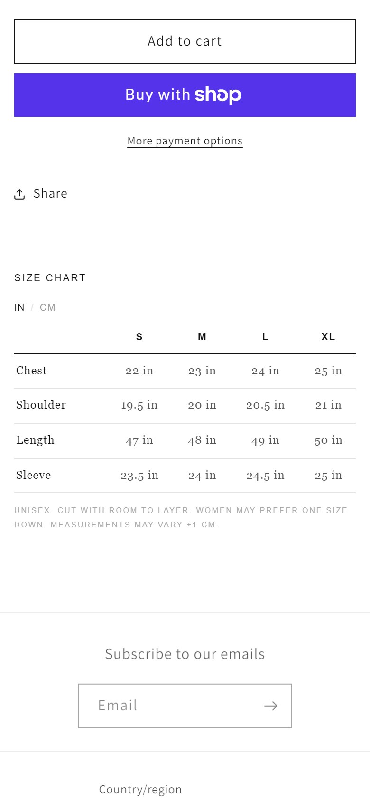
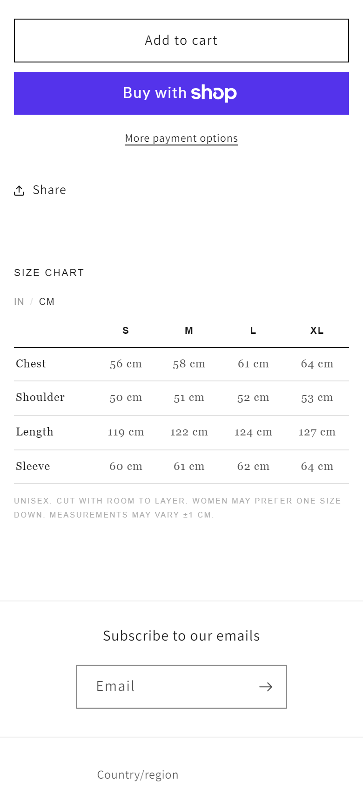
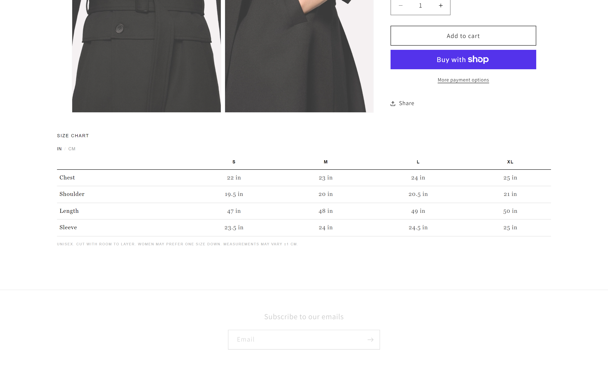
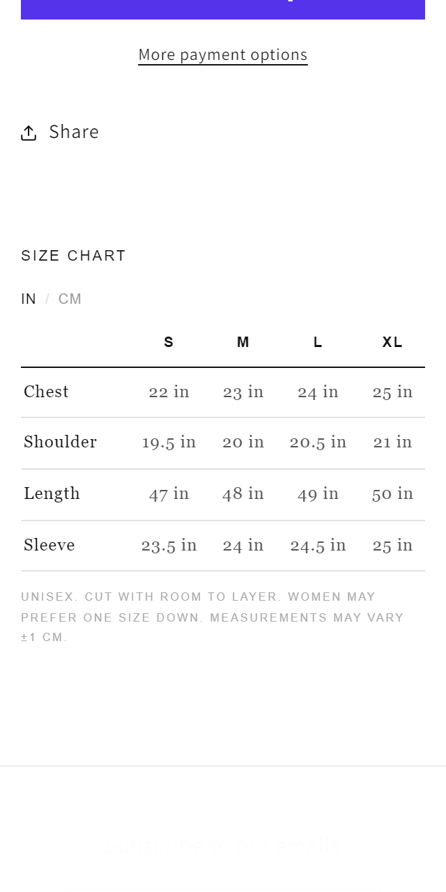

# Portability test: nl-size-chart in stock Dawn

**Date:** 2026-10-21
**Theme:** Dawn 16.0.0, cloned unmodified from github.com/Shopify/dawn and uploaded as an unpublished theme ("Dawn – nl-modules test", #131735126149) on the same store.
**Module:** [nl-size-chart](../nl-size-chart), following its README only.
**Result:** works. About 2 minutes from copying files to a verified chart. One bug found and fixed (text size, below).

| Mobile, inches | Mobile, centimetres | Desktop | 320px |
|---|---|---|---|
|  |  |  |  |

## Steps (as in the README)

1. **Copy the files.** I copied `blocks/nl-size-chart.liquid`, `assets/nl-size-chart.css`, `assets/nl-size-chart.js` and `sections/nl-size-chart-section.liquid` into Dawn. Dawn 16 has no `blocks/` folder, so it was created; Shopify accepts it.
2. **Data definitions.** Already present, because the test theme sits on the same store as Shinsei Line. On a new store, follow [metafields.md](../nl-size-chart/metafields.md).
3. **Place it.** Dawn's `main-product` section uses classic section blocks and can't hold theme blocks. So the module's wrapper section, **Size chart**, goes straight after the main product. In the theme editor that's **Add section › Size chart**. For this test I made the identical change in `templates/product.json` (a new `nl-size-chart-section` with one `nl-size-chart` block, display *Inline*), because the editor can't be driven from the CLI.
4. **Upload and check.** Theme Check reported no offenses in the module files. Dawn's own 10 offenses are unchanged.

## Verified

| Check | 390px | 1440px | 320px |
|---|---|---|---|
| Renders from the product's `nl_modules.size_chart` metaobject | ✓ | ✓ | ✓ |
| Inches match the published chart (22 / 23 / 24 / 25 …) | ✓ | ✓ | ✓ |
| CM toggle switches every cell (56 / 58 / 61 / 64 …) | ✓ | ✓ | ✓ |
| No sideways scroll; table fits its container | ✓ | ✓ | ✓ |
| No JavaScript errors | ✓ | ✓ | ✓ |

## What the test caught

**Text rendered about 40% too small.** Dawn sets `html { font-size: 62.5% }`, so `1rem` is 10px instead of 16px, and the module sized its text in `rem`.

**Fix (all rem-based modules):** text sizes are now `calc(n * var(--nl-rem))`, with `--nl-rem` coming from `--nl-font-size-base`:
- With **nl-core** installed, the base is `1rem`, so browser text-size preferences still apply. In a 62.5% theme, change it to `1.6rem`.
- **Without nl-core**, it falls back to `16px`, so a theme's root size can't shrink the module.

On Shinsei Line the root is 16px, so nothing moved. I re-ran the pixel comparisons there after the fix and they were still identical to the live theme.

## Notes for Dawn users

- **Fonts:** the module's serif falls back to Georgia unless the theme loads EB Garamond. To follow Dawn's own fonts instead, map the tokens once (see [nl-core](../nl-core/README.md#mapping-to-an-existing-theme-instead)).
- **Placement:** as a section the chart sits below the product, at full width. Putting it inside Dawn's product column would mean editing `main-product.liquid` itself. That's not tested here and not needed for the README route. Themes built on theme blocks (e.g. Horizon) take it as a normal block.
- The test theme can be deleted from **Online Store › Themes** at any time.
