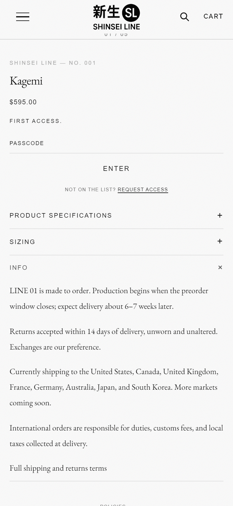
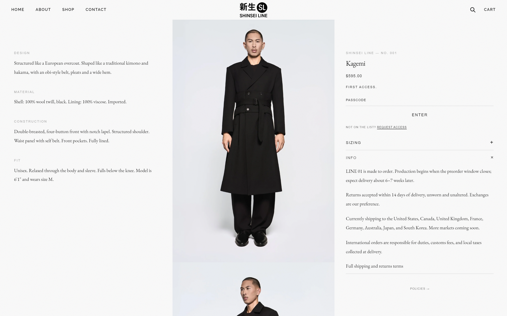

# nl-accordion

A collapsible row (heading + rich text) for shipping notes, care instructions or FAQs. It shares one-open-at-a-time behaviour with the other nl- accordions ([nl-spec-list](../nl-spec-list), [nl-size-chart](../nl-size-chart)).

| Mobile | Desktop |
|---|---|
|  |  |

## What it does

- **Heading and rich text**, edited in the theme editor (paragraphs, bold, italic, links).
- **A real `<button>`** with `aria-expanded` and `aria-controls`, keyboard operable, with a visible focus ring.
- **One open at a time:** opening one dispatches `nl:accordion-open` and the others close. This works across modules and sections.
- **Theme editor:** selecting the block opens it. "Open by default" is a setting.
- Respects `prefers-reduced-motion`. Styled with `--nl-*` tokens, each with a fallback.

## Files

```
blocks/nl-accordion.liquid
sections/nl-accordion-section.liquid   wrapper section: a stack of rows anywhere (Dawn-style themes)
assets/nl-accordion.css
assets/nl-accordion.js
```

## Install

1. **Copy the files** into the same folders of your theme.
2. **Place it:**
   - **Themes with theme blocks:** **Add block** › **Collapsible row**, as many as you need.
   - **Dawn and other classic sections:** **Add section** › **Collapsible rows**. It holds up to 12 rows on any template.
   - **In code:** ``.

## Settings

| Setting | Type | Default |
|---|---|---|
| Heading | Text | Shipping |
| Content | Rich text | placeholder paragraph |
| Open by default | Checkbox | Off |

## Design tokens used

`--nl-font-sans`, `--nl-font-serif`, `--nl-line-height`, `--nl-color-ink`, `--nl-color-text-mid`, `--nl-color-border`, `--nl-space-sm`, `--nl-ease`.

## Notes

- Links in the content inherit the text colour and underline on hover and focus.
- `metafields.md` isn't included because this module needs no custom data.
