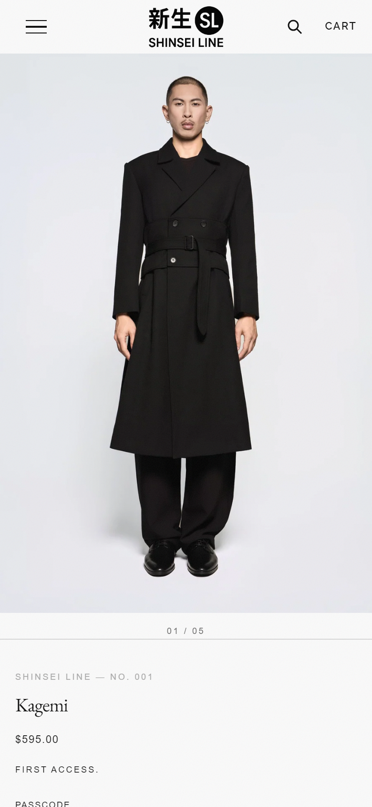
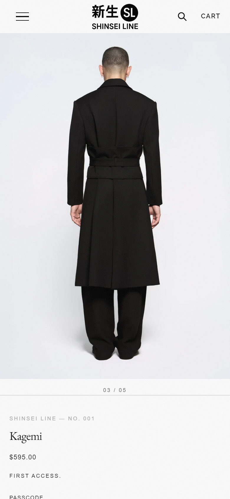
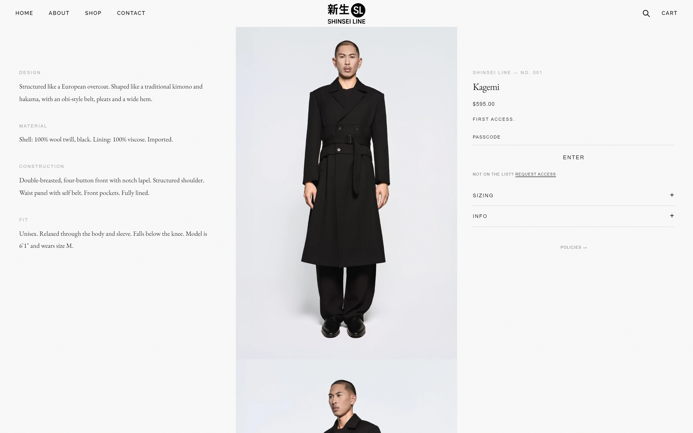

# nl-gallery

Product media as a vertical stack on desktop and a swipe row on mobile, with a quiet "01 / 05" position counter. It can also swipe or stack on every screen.

| Mobile, first image | Mobile, after swiping | Desktop stack |
|---|---|---|
|  |  |  |

## What it does

- **Content:** the product's own media, in the order set on the product. Images, Shopify-hosted videos, YouTube/Vimeo and 3D models are all supported. No metafield or extra setup is needed.
- **Swiping is pure CSS** (scroll snap). It works with JavaScript off.
- **`<nl-gallery>`** (loaded only when the product has more than one media item) adds:
  - **Counter:** updates as the shopper swipes, in the format `01 / 05`, `1 / 5` or `1 of 5`.
  - **Screen-reader announcement** of the current image ("Image 3 of 5") in a polite live region. The visual counter is hidden from screen readers so it isn't read twice.
  - **Arrow keys:** ← and → move one image at a time when the track has focus, smooth or instant depending on `prefers-reduced-motion`.
  - **Carousel semantics only while it swipes:** the track becomes a tab stop described as a carousel only when it scrolls sideways. On a desktop stack it stays a plain labelled region. This updates on resize.
- **Performance:** the first image gets `fetchpriority="high"`; the rest load lazily. Images get a full `srcset` and a configurable `sizes`.
- Styled with `--nl-*` tokens, each with a fallback, so [nl-core](../nl-core) is optional.

## Files

```
blocks/nl-gallery.liquid            the block
sections/nl-gallery-section.liquid  wrapper section for Dawn-style themes
assets/nl-gallery.css
assets/nl-gallery.js
```

## Install

1. **Copy the files** into the same folders of your theme: `blocks/`, `assets/` and, for Dawn-style themes, `sections/`.
2. **Place the block.** Pick one:
   - **Themes with theme blocks in the product section:** theme editor › product template › **Add block** › **Gallery**. Remove the theme's own media gallery block if you're replacing it.
   - **Dawn and other classic product sections:** theme editor › product template › **Add section** › **Gallery**. Note: Dawn's main product section keeps its own gallery, so this works best as a second, editorial gallery, or with Dawn's media hidden.
   - **In code:** ``. If the block sits directly in a CSS grid or flex column, give its parent `min-width: 0` so the swipe row can't widen the layout.
3. **Optional:** install [nl-core](../nl-core).

## Settings

| Setting | Type | Default | Notes |
|---|---|---|---|
| Layout | Stack on desktop, swipe on mobile / Swipe on all screens / Stack on all screens | Stack on desktop, swipe on mobile | Breakpoint 768/769px |
| Desktop image height: screen height minus | Range 0–200px | 56px | Usually your header height, so a full-length photo fits on screen |
| Image sizes attribute | Text | `(max-width: 768px) 100vw, 50vw` | Match how wide the gallery really is |
| Show position counter | Checkbox | On | |
| Format | `01 / 05` / `1 / 5` / `1 of 5` | `01 / 05` | |
| Show counter on | Mobile only / All screens | Mobile only | The counter never shows on a stack |
| Gallery label | Text | Product title | Screen-reader name for the gallery |

## Design tokens used

`--nl-font-sans`, `--nl-color-text-secondary`, `--nl-color-ink`, `--nl-color-bg-alt`.

## Notes

- There are no arrow buttons or dots on purpose: the counter is the only visible control, matching an editorial, low-UI look. Shoppers swipe on touch screens and use the arrow keys on keyboards.
- `metafields.md` isn't included because this module needs no custom data.
