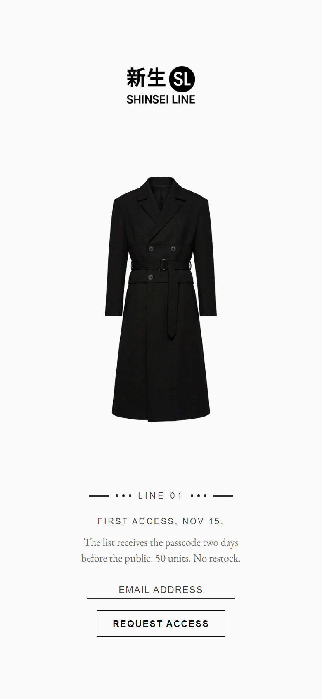
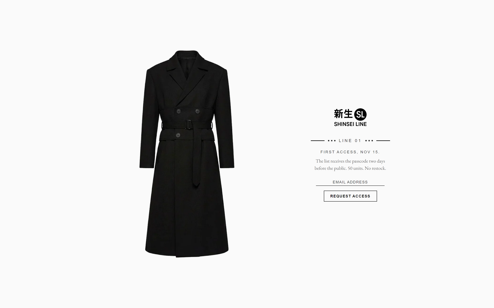
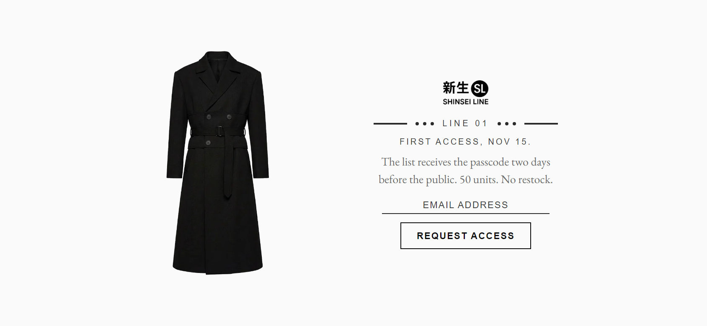

# nl-password

A quiet holding page for a password-protected store: optional product image, logo, a transit-style tag ("— • • • LINE 01 • • • —"), up to three short lines plus a serif sub-line, and an email signup with a pulsing button. Staff reach the real store-password form through an invisible hotspot.

| Mobile | Desktop | Phone, landscape |
|---|---|---|
|  |  |  |

## What it does

- **Everything is a setting.** That covers the image, logo, tag text and ornaments, three lines of copy, a serif sub-line, signup on/off, email placeholder, button label, pulse, success message, the customer tag added to signups, three page colours, and the staff-login copy.
- **Signups become customers.** Shopify's customer form tags each one (default `holding-page`), so you can find them under **Customers** and email them at launch.
- **Instant confirmation.** The success message shows on submit and survives Shopify's page reload, including after a captcha step.
- **Staff access.** An invisible 56×56px hotspot in the top-left corner opens the store-password form and focuses it. A wrong password reopens the form with the error message.
- **Fits any screen on load.** It uses two centred columns on desktop and stacks on portrait phones (logo, image, then tag, copy and form). It tightens on short screens and drops the image on very short portrait screens. There's no scrolling.
- **Motion:** staggered fade-ins, a scanning line in the tag rules, pulsing dots, and a rectangular pulse around the button. `prefers-reduced-motion` turns all of it off.
- `<nl-password>` custom element; no inline scripts. Background, button colour and font use the `--nl-*` tokens, each with a fallback.

## Files

```
sections/nl-password.liquid
assets/nl-password.css
assets/nl-password.js
templates/password.json      example template using this section
```

## Install

1. **Copy** `sections/nl-password.liquid` and both `assets/` files into your theme.
2. **Point the password template at it.** Replace your theme's `templates/password.json` with the one here, or change its section `"type"` to `"nl-password"`.
3. **Hide Shopify's default challenge, if your password layout shows it.** The stylesheet already hides `.shopify-challenge*`. If your `layout/password.liquid` renders its own header or footer, remove them, because this section fills the viewport.
4. In the theme editor, open **Online Store › Preferences › Password protection** (the password page), then pick the **Image** and **Logo** and set the copy.
5. **Optional:** install [nl-core](../nl-core) so the background and font follow theme settings.

## Settings

| Group | Setting | Default |
|---|---|---|
| Media | Image | (none) |
| | Logo | (none: shows the store name) |
| Tag | Tag text | `LINE 01` (empty hides the tag) |
| | Show rules and dots around the tag | On |
| Copy | Line 1 / 2 / 3 | Line 3: `First access, Nov 15.` |
| | Sub-line | `The list receives the passcode two days before the public. 50 units. No restock.` (serif, muted, wraps) |
| Signup | Show email signup | On |
| | Email placeholder | `Email address` |
| | Button label | `Request access` |
| | Pulse around the button | On |
| | Success message | `You're on the list.` |
| | Customer tag | `holding-page` |
| Colours | Text / Rules, dots and underline / Animation highlight | `#3A3A3A` / `#2A2A2A` / `#5A5A5A` |
| Staff login | Password placeholder / Button label / Error message | `Store password` / `Enter` / `Incorrect password.` |

## Design tokens used

`--nl-color-bg`, `--nl-color-text`, `--nl-color-text-secondary`, `--nl-color-error`, `--nl-font-sans`, `--nl-font-serif`, plus the section's own `--nl-password-text`, `--nl-password-line` and `--nl-password-highlight`.

## Notes

- The staff hotspot is deliberately invisible and outside the tab order. Staff using a keyboard can go to `/password` and Shopify's admin preview, or remove `tabindex="-1"` from the hotspot if the shop prefers.
- `metafields.md` isn't included because this module needs no custom data.
