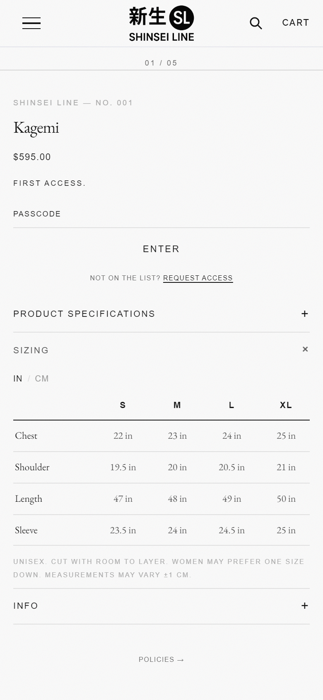
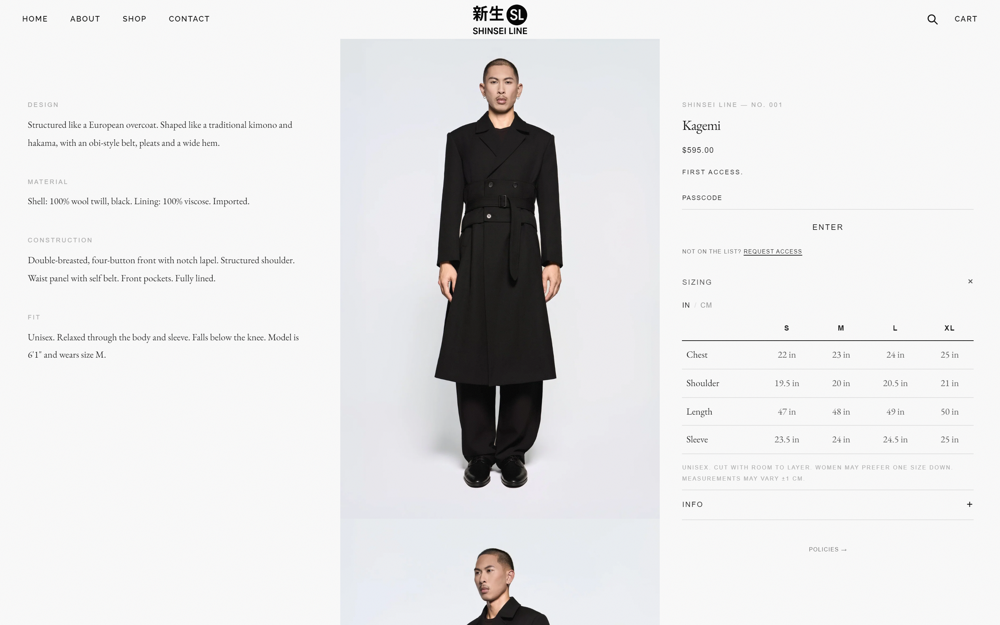

# nl-size-chart

A size chart with an IN/CM toggle. Measurements are stored once, in centimetres, and edited in the Shopify admin. Shows as an accordion or inline.

| Mobile, inches | Mobile, centimetres | Desktop |
|---|---|---|
|  |  |  |

## What it does

- **Data:** reads the product metafield **`nl_modules.size_chart`**, a reference to an `nl_size_chart` metaobject (sizes, measurement rows in cm, fit note, default unit). One chart can serve many products.
- **One set of numbers:** values are entered in centimetres. Inches are calculated as cm ÷ 2.54, rounded to the nearest half inch, which matches how size charts are usually published.
- **Fallback:** if a product has no chart, the block builds one from its own settings. Each measurement is one line in the form `Chest: 56, 58, 61, 64`.
- **Unit toggle:** a `<nl-size-chart>` custom element with two `aria-pressed` buttons.
  - The chosen unit is saved in `localStorage` and applied on the next visit.
  - Every size chart on the page stays in sync through an `nl:size-unit` event.
  - The server renders the default unit, so the table reads correctly before JavaScript loads.
- **Accessible table:** column and row headers use `scope`. A visually hidden caption names the current unit and updates when it changes.
- **No sideways scroll:** compact cell padding on mobile, and cells may wrap below 340px. Tested at 1440, 390 and 320px.
- **Accordion mode** joins the shared `nl:accordion-open` coordination, so opening it closes other nl- accordions and any theme accordion wired in (see [nl-spec-list](../nl-spec-list/README.md#coordinating-with-a-themes-own-accordions)).
- Respects `prefers-reduced-motion`. Styled with `--nl-*` tokens, each with a fallback, so [nl-core](../nl-core) is optional.

## Files

```
blocks/nl-size-chart.liquid            the block
sections/nl-size-chart-section.liquid  wrapper section for Dawn-style themes
assets/nl-size-chart.css
assets/nl-size-chart.js
metafields.md                          definitions and admin steps
```

## Install

Requires an Online Store 2.0 theme.

1. **Copy the files** into the same folders of your theme: `blocks/`, `assets/` and, for Dawn-style themes, `sections/`.
2. **Create the data definitions** by following [metafields.md](metafields.md): two metaobject definitions and one product metafield. You can skip this and use the block's fallback settings only.
3. **Place the block.** Pick one:
   - **Themes with theme blocks in the product section** (Horizon and newer): theme editor › product template › **Add block** › **Size chart**.
   - **Dawn and other classic product sections:** theme editor › product template › **Add section** › **Size chart**. Place it under the product information.
   - **In code:** `` inside any section whose schema allows `@theme` or `nl-size-chart` blocks.
4. **Optional:** install [nl-core](../nl-core) to drive colours and fonts from theme settings.

## Settings

| Setting | Type | Default | Notes |
|---|---|---|---|
| Display | Accordion / Inline | Accordion | |
| Heading | Text | Sizing | Accordion label, or the title in inline mode. Also used in the table caption |
| Show on | All / Desktop only / Mobile only | All | Breakpoint 768/769px |
| **Fallback chart** | | | Used only when the product has no `nl_modules.size_chart` |
| Sizes | Text | `S, M, L, XL` | Comma-separated |
| Measurements (cm) | Textarea | two example rows | One `Label: cm, cm, …` line per measurement |
| Fit note | Textarea | (empty) | |
| Default unit | Inches / Centimetres | Inches | |

## Design tokens used

`--nl-font-sans`, `--nl-font-serif`, `--nl-line-height`, `--nl-color-ink`, `--nl-color-text-mid`, `--nl-color-text-light`, `--nl-color-text-ghost`, `--nl-color-border`, `--nl-space-sm`, `--nl-ease`.

## Tested in stock Dawn

Installed into an unmodified Dawn 16.0.0 by following this README. It took about 2 minutes, worked at 320, 390 and 1440px, and had no JavaScript errors. See [the portability report](../case-study/PORTABILITY.md).

## Notes

- The unit is remembered per browser under the key `nl-size-unit`. If storage is blocked, the toggle still works; the choice just isn't remembered.
- In accordion mode the panel starts hidden and needs JavaScript to open. Use **Inline** if a no-JS view matters.
