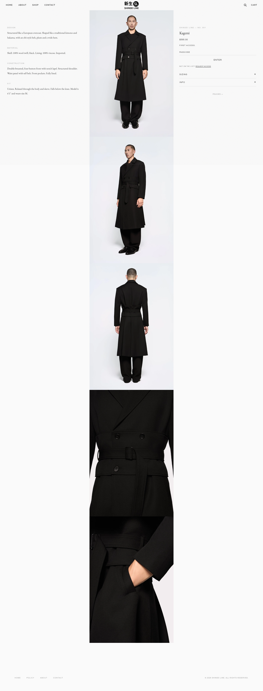
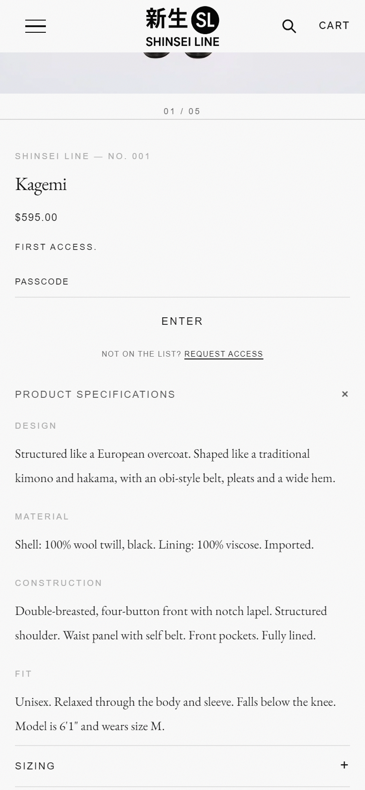

# nl-spec-list

Product specifications (Design, Material, Construction, Fit …) as label/body rows. Shows as an open list or an accordion, editable per product in the Shopify admin.

| Desktop: open list | Mobile: accordion |
|---|---|
|  |  |

## What it does

- Reads the product metafield **`nl_modules.specs`**, a list of `nl_spec` metaobject entries, each with a label and a body. Content lives in the admin, not in code.
- Falls back to **Spec row** child blocks set in the theme editor when a product has no `nl_modules.specs` entries.
- **Display:** Open list, or Accordion. The accordion is a `<nl-spec-list>` custom element: a real `<button>` with `aria-expanded` and `aria-controls`, keyboard operable, with a visible focus ring.
- **Show on:** all screens, desktop only (769px and up) or mobile only (up to 768px). Placing two copies, one per breakpoint, gives a desktop column plus a mobile accordion from the same data.
- Opening one accordion closes the others by dispatching `nl:accordion-open` on `document`. Other nl- modules listen for it, and a host theme can join in too (see below).
- JavaScript loads only in accordion mode. Respects `prefers-reduced-motion`.
- Styled with `--nl-*` design tokens, each with a built-in fallback, so it works with or without [nl-core](../nl-core).

## Files

```
blocks/nl-spec-list.liquid           the block
blocks/_nl-spec-row.liquid           private child block (editor fallback rows)
sections/nl-spec-list-section.liquid wrapper section for themes like Dawn
assets/nl-spec-list.css
assets/nl-spec-list.js
metafields.md                        definitions and admin steps
```

## Install

Requires an Online Store 2.0 theme.

1. **Copy the files** into the same folders of your theme: `blocks/`, `assets/` and, for Dawn-style themes, `sections/`.
2. **Create the data definitions** by following [metafields.md](metafields.md): one metaobject definition and one product metafield.
3. **Place the block.** Pick one:
   - **Themes with theme blocks in the product section** (Horizon and newer): in the theme editor, open a product template, click **Add block** in the product information area, and choose **Specifications**.
   - **Dawn and other themes with classic product sections:** in the theme editor, open a product template, click **Add section** under the product, and choose **Specifications**. The section comes with one Specifications block.
   - **In code:** render it statically inside any section that allows theme blocks:
     ```liquid
     
     ```
     and add `{ "type": "@theme" }` (or `{ "type": "nl-spec-list" }`) to that section's `blocks` schema.
4. **Optional:** install [nl-core](../nl-core) so colours, fonts and spacing come from theme settings.

## Settings

| Setting | Type | Default | Notes |
|---|---|---|---|
| Display | Open list / Accordion | Open list | |
| Heading | Text | Product specifications | Accordion label. In list mode, shown only if the next setting is on |
| Show heading above the list | Checkbox | Off | List mode only |
| Show on | All / Desktop only / Mobile only | All | Breakpoint 768/769px |
| Space between rows | Range 0–64px | 36px | |

**Spec row** (child block): Label (text) and Text (textarea). Only rendered when the product has no `nl_modules.specs` entries.

## Design tokens used

`--nl-font-sans`, `--nl-font-serif`, `--nl-line-height`, `--nl-color-ink`, `--nl-color-text-ghost`, `--nl-color-text-mid`, `--nl-color-border`, `--nl-space-sm`, `--nl-ease`. Each has a fallback in the CSS. To restyle without nl-core, define any of them on `:root`.

## Coordinating with a theme's own accordions

To keep "one open at a time" across your theme's accordions and this one, add this to your theme's accordion script:

```js
// when your accordion opens:
document.dispatchEvent(new CustomEvent('nl:accordion-open', { detail: { source: yourToggleElement } }));

// close yours when an nl accordion opens:
document.addEventListener('nl:accordion-open', (e) => {
  if (e.detail?.source === yourToggleElement) return;
  /* close your accordions */
});
```

## Notes

- The accordion panel starts `hidden` and needs JavaScript to open. Use **Open list** if a no-JS view matters.
- Body text keeps line breaks; HTML is escaped.
